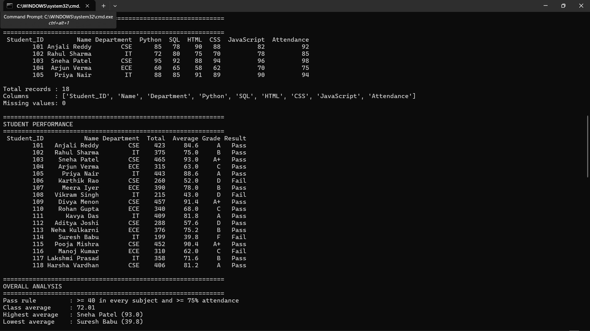
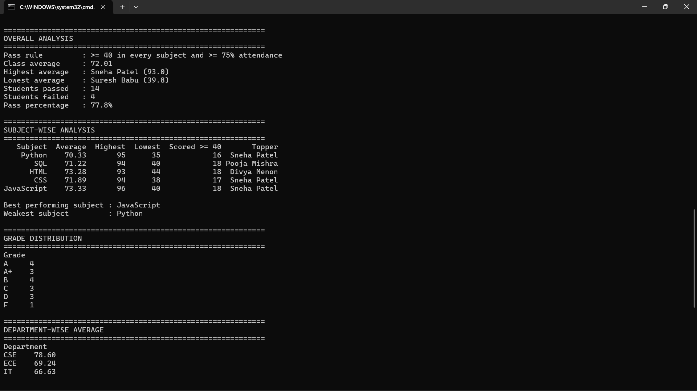
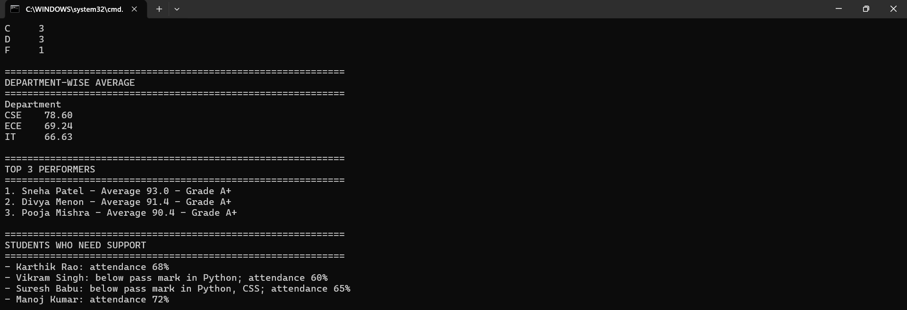

# Project Documentation: Student Performance Analytics System

## 1. Project Title
**Student Performance Analytics System**
Student: Arnav Kumar Malkani | Course: Python with AI, EWB Courses 

## 2. Objective
Calculating totals, grades and results by hand is slow and error-prone. This
project does it automatically: it reads student marks from a CSV file and
reports how each student and the whole class performed, including toppers,
the weakest subject and students who need support.

## 3. Technologies Used
- Python 3
- NumPy (sum, mean, min, max)
- Pandas (CSV loading, DataFrame, sorting, groupby)
- Git and GitHub

## 4. Dataset Description
`students.csv` has **18 records** with these columns: Student_ID, Name,
Department, Python, SQL, HTML, CSS, JavaScript (marks out of 100) and
Attendance (%). The data was prepared by me, with a few weak students included
so the pass/fail logic is properly tested.

## 5. Implementation
1. **Load:** `load_data()` reads the CSV into a DataFrame. `main.py` prints the
   first rows, record count, columns and missing values.
2. **Process:** `process_students()` loops through each student and calls
   `calculate_total()` and `calculate_average()` (NumPy), `assign_grade()` and
   `check_result()`. Total, Average, Grade and Result are added as new columns.
3. **Grading rule:** 90+ A+, 80-89 A, 70-79 B, 60-69 C, 40-59 D, below 40 F.
4. **Pass rule:** at least 40 in every subject and at least 75% attendance.
5. **Analyse:** class average, highest/lowest average and pass count using
   NumPy and Pandas; `subject_analysis()` loops over the subjects for
   average, highest, lowest and topper; `top_performers()` sorts by average.
6. **Output:** results are printed in clear sections and saved to
   `student_results.csv`.

## 6. Key Features
- Total, average, grade and pass/fail for every student
- Highest, lowest and class average
- Subject-wise analysis with toppers
- Department-wise average and grade distribution
- Top 3 performers
- Reasons shown for each failed student

**Main functions:** `load_data`, `calculate_total`, `calculate_average`,
`assign_grade`, `check_result`, `process_students`, `subject_analysis`,
`top_performers`.

## 7. Output / Screenshots

## 8. Final Outcome
The program runs without errors and analyses all 18 students: 14 passed,
4 failed, class average 72.01. Sneha Patel has the highest average (93.0),
JavaScript is the best subject and Python the weakest. All required features
of the assignment are covered.

## 9. Challenges and Learning
**Challenges I faced**
- **Understanding the loop over the DataFrame:** I wasn't sure how to go
  through each student row by row. I learned that `iterrows()` gives the
  row index and the row data, which let me calculate each student's total,
  grade and result.

**What I learned**
- How to load and organise data with Pandas, and how NumPy functions like
  `np.sum`, `np.mean` and `np.min` make calculations simpler.
- Why keeping reusable code in a separate `functions.py` makes `main.py`
  shorter and easier to read.

## 10. GitHub Repository
https://github.com/ArkMax9/student-performance-analytics.git
